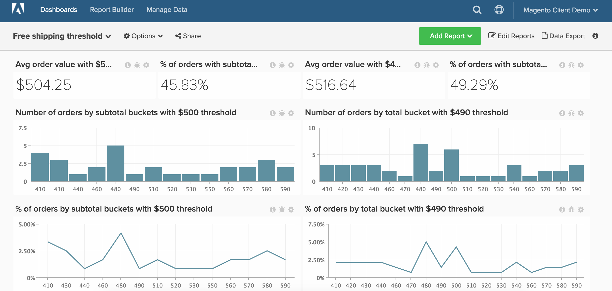

# Envio gratuito

>[!NOTE]
>
>Este tópico contém instruções para clientes que estão usando a arquitetura original e a nova arquitetura. Você está na nova arquitetura se tiver a seção `Data Warehouse Views` disponível após selecionar `Manage Data` na barra de ferramentas principal.

Este tópico demonstra como configurar um painel que acompanha o desempenho do limite de frete gratuito. Esse painel, mostrado abaixo, é uma ótima maneira de testar dois limites de frete gratuito A/B. Por exemplo, sua empresa pode não ter certeza se você deve oferecer frete gratuito a US$ 50 ou US$ 100. Você deve executar um teste A/B de dois subconjuntos aleatórios de seus clientes e executar a análise em [!DNL Commerce Intelligence].

Antes de começar, você deseja identificar dois períodos separados nos quais havia valores diferentes para o limite de frete gratuito da sua loja.

Esta análise contém [colunas calculadas avançadas](../data-warehouse-mgr/adv-calc-columns.md).

## Colunas calculadas

Se você estiver na arquitetura original (por exemplo, se não tiver a opção `Data Warehouse Views` no menu `Manage Data`), entre em contato com a equipe de suporte para criar as colunas abaixo. Na nova arquitetura, essas colunas podem ser criadas na página `Manage Data > Data Warehouse`. As instruções detalhadas são fornecidas abaixo.

* Tabela **`sales_flat_order`**
  * Esse cálculo cria períodos em incrementos relativos aos tamanhos típicos do carrinho. Isso pode variar de incrementos, incluindo, 5, 10, 50, 100

* **`Order subtotal (buckets)`** Arquitetura original: criada por um analista como parte de seu tíquete `[FREE SHIPPING ANALYSIS]`
* **`Order subtotal (buckets)`** Nova arquitetura:
  * Como mencionado acima, esse cálculo cria intervalos em incrementos relativos aos tamanhos típicos do carrinho. Se você tiver uma coluna de subtotal nativa como `base_subtotal`, ela poderá ser usada como base para essa nova coluna. Caso contrário, pode ser uma coluna calculada que exclui frete e descontos da receita.

  >[!NOTE]
  >
  >Os tamanhos do &quot;balde&quot; dependem do que é apropriado para você como cliente. Você pode começar com `average order value` e criar alguns compartimentos menores e maiores que essa quantidade. Ao observar o cálculo abaixo, você vê como copiar facilmente parte da query, editá-la e criar compartimentos adicionais. O exemplo é feito em incrementos de 50.

  * `Column type - Same table, Column definition - Calculation, Column Inputs-` `base_subtotal`, ou `calculated column`, `Datatype`: `Integer`
  * [!UICONTROL Calculation]&#x200B;: `case when A >= 0 and A<=200 then 0 - 200`
    quando `A< 200` e `A <= 250` então `201 - 250`
    quando `A<251` e `A<= 300` então `251 - 300`
    quando `A<301` e `A<= 350` então `301 - 350`
    quando `A<351` e `A<=400` então `351 - 400`
    quando `A<401` e `A<=450` então `401 - 450`
    senão &#39;acima de 450&#39;
    fim

## Métricas

Nenhuma métrica nova!!!

>[!NOTE]
>
>[adicione todas as novas colunas como dimensões às métricas](../data-warehouse-mgr/manage-data-dimensions-metrics.md) antes de criar novos relatórios.

## Relatórios

* **Valor médio de pedido com a regra de remessa A**
  * [!UICONTROL Metric]&#x200B;: `Average order value`

* Métrica `A`: `Average Order Value`
* [!UICONTROL Time period]&#x200B;: `Time period with shipping rule A`
* &#x200B;
  [!UICONTROL Interval]&#x200B;: `None`
* &#x200B;
  [!UICONTROL Chart Type]&#x200B;: `Scalar`

* **Número de pedidos por compartimentos de subtotal com regra de remessa A**
  * [!UICONTROL Metric]&#x200B;: `Number of orders`

  >[!NOTE]
  >
  >Você pode cortar a extremidade final mostrando os `X` `sorted by` `Order subtotal` (compartimentos) no `Show top/bottom`.

* Métrica `A`: `Number of orders`
* [!UICONTROL Time period]&#x200B;: `Time period with shipping rule A`
* &#x200B;
  [!UICONTROL Interval]&#x200B;: `None`
* [!UICONTROL Group by]&#x200B;: `Order subtotal (buckets)`
* &#x200B;
  [!UICONTROL Chart Type]&#x200B;: `Column`

* **Porcentagem de pedidos por subtotal com regra de remessa A**
  * [!UICONTROL Metric]&#x200B;: `Number of orders`

  * [!UICONTROL Metric]&#x200B;: `Number of orders`
  * &#x200B;
    [!UICONTROL Agrupar por]&#x200B;: `Independent`
  * [!UICONTROL Formula]&#x200B;: `(A / B)`
  * &#x200B;
    [!UICONTROL Format]&#x200B;: `%`

* Métrica `A`: `Number of orders by subtotal (hide)`
* Métrica `B`: `Total number of orders (hide)`
* [!UICONTROL Formula]&#x200B;: `% of orders`
* [!UICONTROL Time period]&#x200B;: `Time period with shipping rule A`
* &#x200B;
  [!UICONTROL Interval]&#x200B;: `None`
* [!UICONTROL Group by]&#x200B;: `Order subtotal (buckets)`
* &#x200B;
  [!UICONTROL Chart Type]&#x200B;: `Line`

* **Percentual de pedidos com subtotal excedendo a regra de remessa A**
  * [!UICONTROL Metric]&#x200B;: `Number of orders`
  * &#x200B;
    [!UICONTROL Perspective]&#x200B;: `Cumulative`

  * [!UICONTROL Metric]&#x200B;: `Number of orders`
  * &#x200B;
    [!UICONTROL Agrupar por]&#x200B;: `Independent`

  * [!UICONTROL Formula]&#x200B;: `1- (A / B)`
  * &#x200B;
    [!UICONTROL Format]&#x200B;: `%`

* Métrica `A`: `Number of orders by subtotal`
* Métrica `B`: `Total number of orders (hide)`
* [!UICONTROL Formula]&#x200B;: `% of orders`
* [!UICONTROL Time period]&#x200B;: `Time period with shipping rule A`
* &#x200B;
  [!UICONTROL Interval]&#x200B;: `None`
* [!UICONTROL Group by]&#x200B;: `Order subtotal (buckets)`
* &#x200B;
  [!UICONTROL Chart Type]&#x200B;: `Line`

Repita as etapas e relatórios acima para a Entrega B e o período com a regra de entrega B.

Após compilar todos os relatórios, você pode organizá-los no painel conforme desejar. O resultado pode parecer com a imagem na parte superior desta página.
