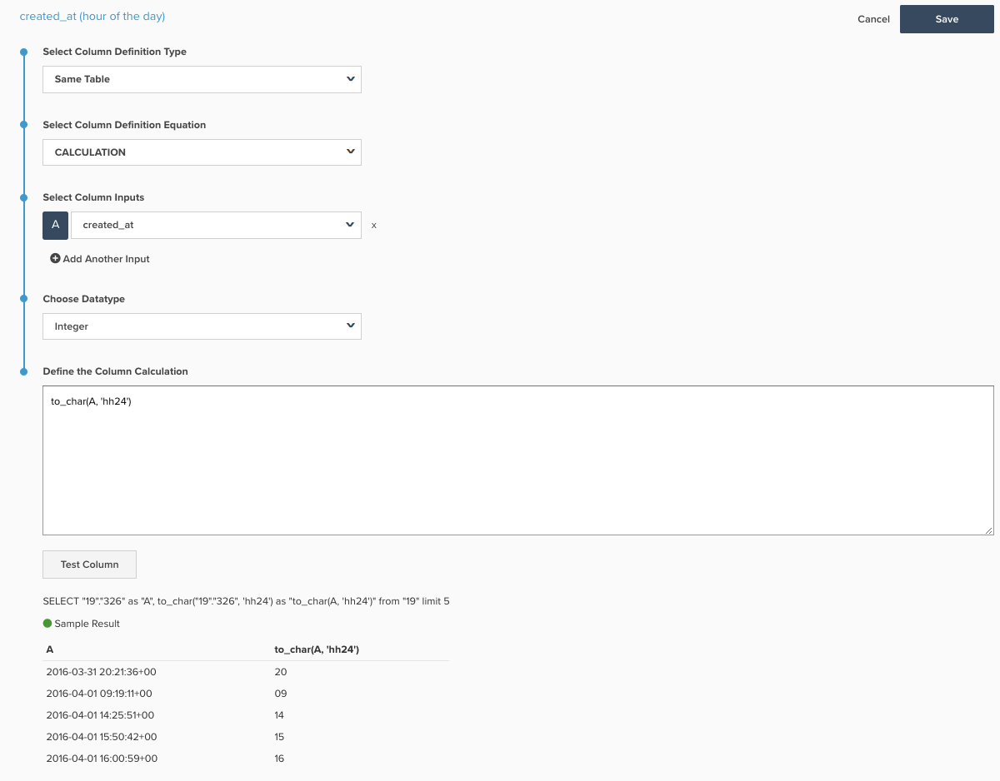

# Relatório em Períodos de Tempo

>[!NOTE]
>
>Este tópico contém instruções para clientes que estão usando a arquitetura original e a nova arquitetura. Você está na [nova arquitetura](../../administrator/account-management/new-architecture.md) se tiver a seção [!DNL _Exibições do Data Warehouse_] disponível após selecionar [!DNL Manage Data] na barra de ferramentas principal.

O Report Builder permite ver facilmente as tendências ao longo do tempo e alterar a perspectiva dos períodos que você deseja comparar. Este tópico demonstra como configurar um painel para detalhar, permitindo criar relatórios para análises semana a semana, mês a mês e ano a ano.

Antes de começar, você deve examinar as perspectivas mais detalhadamente [aqui](../../tutorials/using-visual-report-builder.md) e as opções de tempo independentes [aqui](../../tutorials/time-options-visual-rpt-bldr.md).

Esta análise contém [colunas calculadas avançadas](../data-warehouse-mgr/adv-calc-columns.md).

## Colunas calculadas

* Tabela **`Sales_flat_order`**
* **Arquitetura original:** as colunas abaixo são criadas por um analista como parte do seu tíquete `[YoY WoW MoM ANALYSIS]`
* `created_at (month-day)`
* `created_at (month)`
* `created_at (day of the month)`
* `created_at (day of the week)`
* `created_at (hour of the day)`

* **Nova arquitetura:** SQL listado abaixo com uma foto de um exemplo de como criar este cálculo
  * `created_at (month-day)` [!UICONTROL Calculation]: **to_char(A, &#39;mm-dd&#39;)**
  * `created_at (month)` [!UICONTROL Calculation]: **to_char(A, &#39;mm-month&#39;)**
  * `created_at (day of the month)`&lt; [!UICONTROL Calculation]: **to_char(A, &#39;dd&#39;)**
  * `created_at (day of the week)` [!UICONTROL Calculation]: **to_char(A, &#39;d-Day&#39;)**
  * **`created_at (hour of the day)` [!UICONTROL Calculation]: &#x200B;** to_char(A, &#39;hh24&#39;)**
    

## Métricas

Nenhum.

>[!NOTE]
>
>[adicione todas as novas colunas como dimensões às métricas](../data-warehouse-mgr/manage-data-dimensions-metrics.md) antes de criar novos relatórios.

## Relatórios

* **Gráfico YoY**
  * [!UICONTROL Metric]&#x200B;: `Number of orders`

  * [!UICONTROL Metric]&#x200B;: `Number of orders`
  * [!UICONTROL Time options]: `Time range (Custom)`: `2 years ago to 1 year ago`

  * [!UICONTROL Show top/bottom]: 100% melhores classificados por **`created_at (month-day)`***

* Métrica `A`: `This year`
* Métrica `B`: `Last year`
* [!UICONTROL Time period]&#x200B;: `1 year ago to 0 years ago`
* &#x200B;
  [!UICONTROL Interval]&#x200B;: `None`
* [!UICONTROL Group by]&#x200B;: `created_at (month-day)`
* &#x200B;
  [!UICONTROL Chart Type]&#x200B;: `Line`

* **Gráfico MoM**
  * [!UICONTROL Metric]&#x200B;: `Number of orders`

  * [!UICONTROL Metric]&#x200B;: `Number of orders`
  * Opções de tempo: `Time range (Custom)`: `2 months ago to 1 month ago`

  * Mostrar superior/inferior: 100% principais classificados por **`created_at (day of month)`***

* Métrica `A`: Este mês*
* Métrica `B`: mês passado*
* [!UICONTROL Time period]: um mês atrás para 0 meses atrás
* &#x200B;
  [!UICONTROL Interval]&#x200B;: None
* [!UICONTROL Group by]&#x200B;: `created_at (day of month)`
* &#x200B;
  [!UICONTROL Chart Type]&#x200B;: Line

* **Gráfico mundial**
  * [!UICONTROL Metric]&#x200B;: `Number of orders`

  * [!UICONTROL Metric]&#x200B;: `Number of orders`
  * [!UICONTROL Time options]: `Time range (Custom)`: `2 weeks ago to 1 week ago`

  * [!UICONTROL Show top/bottom]: 100% melhores classificados por `created_at (day of week)`

* Métrica `A`: `This week`
* Métrica `B`: `Last week`
* [!UICONTROL Time period]&#x200B;: `1 week ago to 0 weeks ago`
* &#x200B;
  [!UICONTROL Interval]&#x200B;: `None`
* [!UICONTROL Group by]&#x200B;: `created_at (day of week)`
* &#x200B;
  [!UICONTROL Chart Type]&#x200B;: `Line`

* **Gráfico DoD**
  * [!UICONTROL Metric]&#x200B;: `Number of orders`

  * [!UICONTROL Metric]&#x200B;: `Number of orders`
  * [!UICONTROL Time options]: `Time range (Custom)`: `2 days ago to 1 day ago`

  * [!UICONTROL Show top/bottom]: 100% melhores classificados por `created_at (hour of day)`

* Métrica `A`: `Today`
* Métrica B: `Yesterday`
* [!UICONTROL Time period]&#x200B;: `1 day ago to 0 days ago`
* &#x200B;
  [!UICONTROL Interval]&#x200B;: `None`
* [!UICONTROL Group by]&#x200B;: `created_at (hour of day)`
* &#x200B;
  [!UICONTROL Chart Type]&#x200B;: `Line`

Após compilar todos os relatórios, você pode organizá-los no painel conforme desejar. O resultado pode parecer com a imagem na parte superior desta página.
