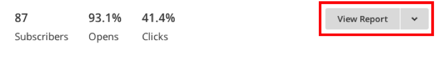
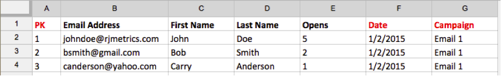
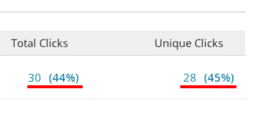
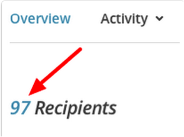
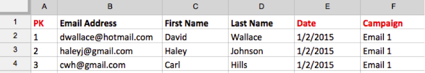

# Importar dados de [!DNL Mailchimp]

Para obter uma visão abrangente de seus esforços de campanha, você pode importar os dados da campanha por email do [!DNL Mailchimp] para o [!DNL Commerce Intelligence]. Para concluir a importação, é necessário fazer o seguinte para cada campanha do [!DNL Mailchimp] que você tiver:

## Exportar dados de aberturas {#opens}

1. Depois de fazer logon no [!DNL Mailchimp], vá para a guia `Campaigns`.

   

1. Clique em **[!UICONTROL View Report]**, ao lado do nome da campanha.

   

1. Clique no número **[!UICONTROL Opened]**.

   

1. Clique em **[!UICONTROL Export]** e salve o arquivo `.csv`.

   Você deve adicionar `primary key`, `date (mm/dd/yyyy)` e `campaign name` colunas a este arquivo. Verifique se os `primary keys` são exclusivos para cada linha.

   

## Exportar dados de cliques {#clicks}

1. Volte para a tela `View Report` da campanha.

1. Clique no número que `Clicked`.

   

1. Clique no número sob a coluna `Total Clicks` OU `Unique Clicks`.

   

1. Clique em **[!UICONTROL Export]** e salve o arquivo `.csv`.

   Você deve adicionar `Primary Key`, `date (mm/dd/yyyy)`, `campaign name` e `URL` colunas a este arquivo. Não é necessário adicionar o URL completo, apenas algo que permite saber o que foi clicado.

   

1. Repita as etapas 3 e 4 para cada URL clicada em seu email, combinando todos os dados no mesmo arquivo `.csv` quando terminar.

## Exportar dados enviados {#sent}

1. Vá para a guia `Campaigns` de [!DNL Mailchimp].

1. Clique em **[!UICONTROL View Report]** ao lado do nome da campanha.

1. Clique no número ao lado de `Recipients`.

   

1. Clique em **[!UICONTROL Export]** e salve o arquivo `.csv`.

   Você deve adicionar `Primary Key`, `date (mm/dd/yyyy)` e `campaign name` colunas a este arquivo.

   

## Preparar arquivos para carregá-los em [!DNL Commerce Intelligence] {#upload}

Cada arquivo - `Opens`, `Clicks` e `Sent` - deve ser carregado para [!DNL Commerce Intelligence] como um arquivo separado. A Adobe recomenda nomear os arquivos usando esta convenção de nomenclatura: `MailChimp\_ACTION\_DATE`. Substitua `ACTION` por `Open`, `Click` ou `Sent` e substitua `DATE` pela data de exportação.

Quando estiver pronto para carregar os arquivos, use o recurso [`File Upload`](../connecting-data/using-file-uploader.md) para trazer os dados para sua Data Warehouse.
