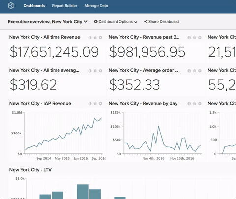

# Renomear um painel

>[!NOTE]
>
>Exige [permissões de Administrador](../../administrator/user-management/user-management.md) ou `Standard` para executar essas funções. Se você for um usuário do `Standard`, também precisará de `Edit` permissões para o painel.

Às vezes os nomes simplesmente não cabem mais. Renomear um painel é rápido e fácil.

1. No painel, clique no menu **[!UICONTROL Dashboard Options]** na parte superior da tela, localizada ao lado do menu `Global Search`.

1. Clique em **[!UICONTROL Rename]** na lista suspensa.

1. Quando solicitado, insira o novo nome do painel.

1. Clique em **[!UICONTROL Save Changes]**.

Exemplo:

