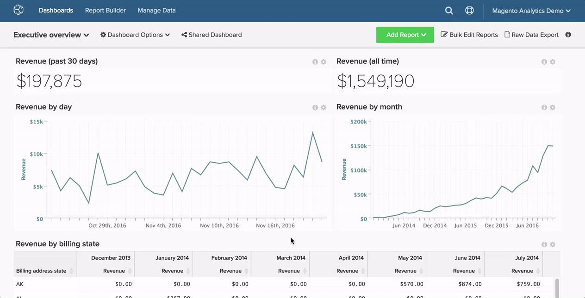
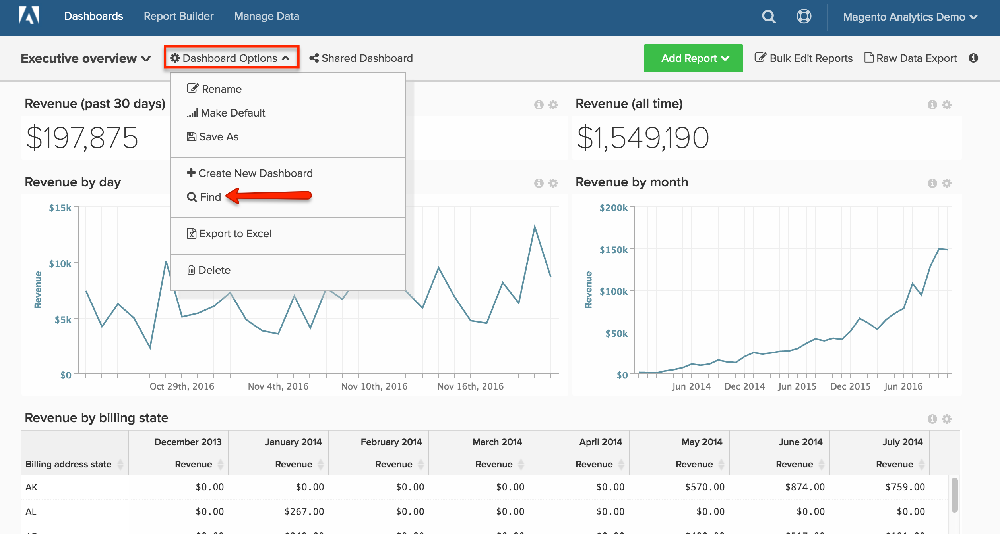

# Pesquisar um painel

Este tópico mostra como usar o [[!DNL Global Search] recurso](#global) para procurar painéis e como procurar [painéis de propriedade de outros usuários](#other).

## Pesquisa global {#global}

O menu [!DNL Global Search] permite procurar e selecionar painéis para exibição.

* *Para exibir uma lista de seus painéis existentes*, clique no painel.

* *Para pesquisar um painel*, digite alguns critérios de pesquisa na barra de pesquisa depois de clicar na lista suspensa do painel. Se algum painel corresponder aos critérios, será exibido primeiro na lista.

Exemplo:

## Localizar painéis de propriedade de outros usuários {#other}

Procurando um painel de propriedade de outro usuário? Se o painel puder ser visualizado por outras pessoas, você poderá pesquisá-lo clicando em **[!UICONTROL Find]** na lista suspensa `Dashboard Options`.

